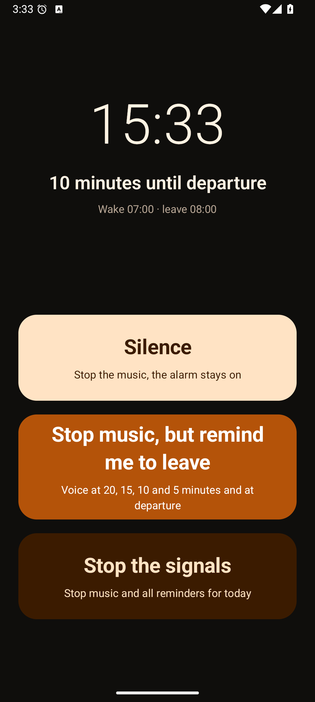
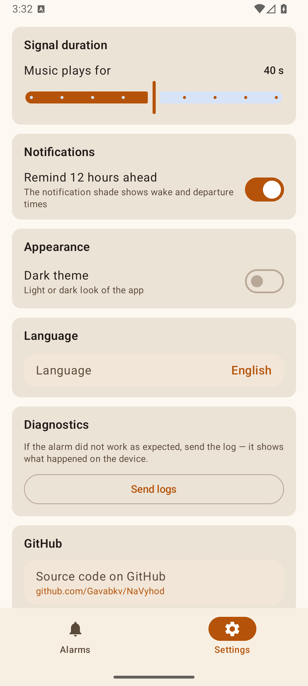

# Ora di uscire

[Русский](README.md) · [English](README.en.md) · [Español](README.es.md) ·
[Deutsch](README.de.md) · [日本語](README.ja.md) · [Français](README.fr.md) ·
[Português](README.pt.md) · [**Italiano**](README.it.md)

Sveglia per Android con due orari per ogni sveglia: **risveglio** e **uscita
di casa**. Si possono creare più sveglie — ognuna con i propri giorni della
settimana, orari e impostazioni.

* Il primo segnale suona esattamente all'ora del risveglio.
* Poi la musica suona ogni **5 o 10 minuti** (configurabile), dal risveglio
  fino all'uscita.
* N minuti prima dell'inizio degli annunci vocali (configurabile, 5–120), la
  musica si arricchisce di frasi TTS di sistema: «Mancano 25 minuti
  all'uscita».
* I promemoria di uscita suonano a **20, 15, 10 e 5 minuti** e esattamente
  all'ora di uscita: «È ora di uscire».
* Se l'ora di uscita è precedente a quella del risveglio, l'uscita conta il
  giorno dopo (ad esempio, risveglio 23:00, uscita 07:00).
* Modalità **«solo promemoria»** — senza musica né vibrazione, solo promemoria
  vocali sull'uscita.
* Nelle impostazioni si può attivare o disattivare l'ora attuale prima della
  frase — separatamente per segnali della sveglia, promemoria di uscita e di
  ritardo: «Sono le 7 e 5 minuti».
* Giorni della settimana: ogni giorno, feriali, fine settimana o qualsiasi
  combinazione.
* Nell'editor della sveglia si imposta la preparazione dal risveglio
  all'uscita (40–150 minuti); si può impostare solo l'ora di uscita — il
  risveglio viene calcolato.
* Tema scuro e **8 lingue dell'interfaccia**: inglese (predefinito), russo,
  spagnolo, tedesco, giapponese, francese, portoghese e italiano. La lingua
  segue il sistema e può essere scelta manualmente nelle impostazioni — il
  menu si trova tra «Aspetto» e «Diagnostica».

## Screenshot

| Sveglie | Editor della sveglia | Schermata del segnale |
|:---:|:---:|:---:|
|  |  |  |

| Impostazioni | Lingua e GitHub | Tema scuro |
|:---:|:---:|:---:|
|  |  |  |

## Notifiche e schermata del segnale

* **12 ore prima del risveglio** appare la notifica «Sveglia impostata» e
  resta nel pannello. Si può scorrere per rimuoverla — allora non tornerà
  fino al ciclo successivo. La notifica può essere disattivata del tutto
  nelle impostazioni.
* **Mentre suona la musica** alla notifica si aggiungono i pulsanti
  «Posticipa», «Ricorda» e «Ferma», e sullo schermo compare una **finestra a
  schermo intero** con tre grandi pulsanti di colori diversi (chiaro, ambra e
  scuro), così anche una persona assonnata riesce a premerli.
* «Silenzio» ferma la musica e la vibrazione, ma la sveglia continua: i
  segnali successivi suonano secondo il programma.
* «Ferma la musica, ma ricordami di uscire» chiede sempre **«Sei sicuro?»**:
  dopo la conferma la musica si spegne, i promemoria vocali di uscita restano.
* «Ferma i segnali» chiede sempre **«Sei sicuro?»** e dopo la conferma
  spegne musica, promemoria e programma senza riattivare automaticamente
  domani. La sveglia può essere reimpostata manualmente, anche lo stesso
  giorno.
* La notifica resta fino alla fine del ciclo o fino allo spegnimento
  confermato.
* Se la sveglia non viene fermata manualmente prima dell'ora di uscita, dopo
  l'uscita la voce annuncia il ritardo tre volte ogni minuto con una **pausa
  di 3 secondi tra le frasi** (categoria «Ritardo» nelle impostazioni voce).
  Contemporaneamente compare una finestra che propone di fermare i segnali; i
  promemoria continuano fino alla disattivazione manuale.

## Come funziona

```
AlarmManager (setAlarmClock, un PendingIntent separato per ogni sveglia)
        │  scatta esattamente all'ora del segnale, ripetizione +30 secondi
        ▼
AlarmReceiver ── imposta subito il segnale successivo e avvia il servizio
        │
        ├─ «impostata»: allarme separato 12 ore prima del risveglio
        ├─ promemoria di uscita: allarmi separati a 20/15/10/5/0 minuti
        └─ ritardo dopo riavvio: un allarme di recupero
        ▼
AlarmService (foreground, mediaPlayback)
        ├─ MediaPlayer: suoneria di sveglia di sistema (loop)
        ├─ VoiceSpeaker: TTS nella lingua scelta
        ├─ vibrazione
        ├─ full-screen intent → AlarmRingingActivity (finestra con pulsanti)
        └─ notifica: «Posticipa» / «Ricorda» / «Ferma»
```

* La notifica di stato (ID 1001, canale `alarm_status`) è separata da quella
  del segnale (ID 1002, canale `alarm_ringing`) così la finestra a schermo
  intero si apre di nuovo.
* Ogni segnale ha una ripetizione dopo 30 secondi che porta l'ora originale
  del segnale, così un segnale già consegnato non scatta due volte.
* Dopo il segnale di uscita il servizio foreground resta attivo fino allo
  spegnimento: i promemoria al minuto girano al suo interno, senza allarmi
  separati limitati dal Doze.
* Il segnale successivo è calcolato dalla logica pura `SchedulePlanner`
  (senza dipendenze Android, coperta da unit test).
* Si usa `setAlarmClock` invece di `setExact*`: il sistema considera questo
  allarme una vera sveglia — esce dal Doze e non è soggetto ai limiti di
  avvio in background dei servizi foreground.
* Il ciclo attivo e quello fermato sono in SharedPreferences protette dal
  dispositivo; dopo riavvio, aggiornamento dell'app o cambio di fuso orario
  `BootReceiver` reimposta i segnali. Le impostazioni sono disponibili in
  Direct Boot: la sveglia viene ripristinata prima del primo PIN.
* Il TTS parla via `USAGE_ALARM` al volume della sveglia; durante la frase la
  musica viene abbassata. La lingua del TTS segue quella dell'app.
* L'audio focus `AUDIOFOCUS_GAIN_TRANSIENT` mette in pausa musica/video di
  altre app mentre suona il segnale.
* La finestra del segnale viene mostrata sopra il blocco schermo
  (`showWhenLocked`, `turnScreenOn`) e il pulsante indietro è bloccato: la
  scelta deve essere consapevole.
* Il diario locale `AlarmLog` registra gli eventi dei segnali; nelle
  impostazioni può essere inviato da «Diagnostica» (il file è condiviso tramite
  FileProvider).

## Permessi

Al primo avvio l'app passa **una volta** sui permessi mancanti; quelli già
concessi non vengono richiesti di nuovo.

* **Sveglie esatte** — senza di esse il segnale può arrivare in ritardo.
* **Notifiche** — la notifica «sveglia impostata» e i pulsanti del segnale.
* **Finestra pop-up del segnale** (Android 14+) — perché la finestra con i
  pulsanti appaia sopra il blocco schermo.
* **Accensione schermo** (Android 14+) — senza, la finestra del segnale può
  non accendere il display: la musica suona e lo schermo resta nero. Inoltre
  lo schermo viene svegliato tramite `WakeLock`.
* **Accesso a «Non disturbare»** — per avvisare se la politica audio può
  silenziare il segnale.
* **Canale «Segnale sveglia»** — se l'utente lo ha silenziato, l'app propone
  di correggerlo.
* **Ignorare l'ottimizzazione della batteria** — su firmware Xiaomi,
  realme/ColorOS, Huawei e simili, senza questo i segnali possono ritardare o
  il processo viene terminato.

Il suono proviene dalle impostazioni di sistema: «Impostazioni → Audio →
Sveglia». Se non è impostata una suoneria di sveglia, si usa la suoneria di
chiamata/notifica e, in ultima istanza, un tono integrato.

## Compilazione

Servono JDK 17+ e Android SDK (compileSdk 36, build-tools 36).
Progetto: AGP 8.9.1, Gradle 8.11.1, Kotlin 2.0.20, minSdk 26.

```bash
# Windows
set JAVA_HOME=C:\Program Files\Android\Android Studio\jbr
gradlew.bat assembleDebug

# Linux / macOS
./gradlew assembleDebug
```

APK: `app/build/outputs/apk/debug/app-debug.apk`

Installazione:

```bash
adb install -r app/build/outputs/apk/debug/app-debug.apk
```

Test (unit test della pianificazione e Robolectric per UI/servizio):

```bash
gradlew.bat testDebugUnitTest
```

## Build di release e Google Play

Pacchetto dell'applicazione: `com.gavrovis.navyhod`.

La firma viene letta dal `keystore.properties` locale nella radice del
progetto (file e chiave `*.jks` sono nel `.gitignore` e non finiscono nel
repository):

```properties
storeFile=navyhod-upload.jks
storePassword=…
keyAlias=navyhod
keyPassword=…
```

Build dell'App Bundle firmato per Play:

```bash
gradlew.bat bundleRelease
# → app/build/outputs/bundle/release/app-release.aab
```

Prima di pubblicare su Play Console servono dichiarazioni per i permessi
limitati (sveglie esatte, full-screen intent, esenzione dall'ottimizzazione
della batteria, tipo di servizio foreground `mediaPlayback`), un'informativa
sulla privacy e il modulo Data safety compilato. L'app non ha bisogno di rete:
nessun dato viene raccolto o inviato, i log l'utente li condivide a mano.

## Struttura

```
app/src/main/java/com/gavrovis/navyhod/
├── AlarmItem.kt            sveglia: orari, giorni, modalità di preparazione
├── AlarmSettings.kt        impostazioni comuni (data class)
├── SettingsStore.kt        SharedPreferences in storage protetto
├── SchedulePlanner.kt      calcolo di ciclo, segnali e ritardi (logica pura)
├── SpeechText.kt           frasi TTS in 8 lingue
├── LocaleHelper.kt         scelta automatica della lingua e wrapper del contesto
├── StatusNotifier.kt       canali e stati delle notifiche (ID 1001/1002)
├── AlarmScheduler.kt       allarmi esatti, ripetizioni +30 s, promemoria
├── AlarmReceiver.kt        ricezione allarmi → segnale successivo / servizio
├── AlarmService.kt         musica, TTS, vibrazione, finestra del segnale, ritardo
├── VoiceSpeaker.kt         wrapper di TextToSpeech
├── AlarmRingingActivity.kt finestra a schermo intero sopra il blocco
├── BootReceiver.kt         ripristino dopo riavvio/cambio d'ora
├── AlarmLog.kt             diario locale per la diagnostica
├── MainActivity.kt         punto di ingresso, scansione unica dei permessi
├── NaVykhodApp.kt          Application
└── ui/
    ├── AppScreen.kt        schede, lista sveglie, editor
    ├── SettingsTab.kt      segnali, voce, notifiche, tema, lingua, log
    ├── ScreenParts.kt      elementi comuni e formattazione
    ├── RingingScreen.kt    grandi pulsanti della finestra del segnale
    └── theme/Theme.kt      tema chiaro/scuro caldo
```

Set di risorse: `values` (inglese), `values-ru`, `values-es`, `values-de`,
`values-ja`, `values-fr`, `values-pt`, `values-it`; l'elenco delle lingue è in
`res/xml/locales_config.xml`.

## Limitazioni

* La melodia è il suono di sveglia di sistema; non c'è player/playlist
  integrato.
* Il volume del segnale è quello della sveglia di sistema (se è a zero, sarà
  basso, come per qualsiasi sveglia).
* Su dispositivi con risparmio energetico aggressivo (alcuni OEM)
  l'affidabilità dipende dal permesso di lavoro in background.
* Se al mattino la musica suona ma lo schermo non si accende, controlla la
  scheda «Permessi e avvisi» nelle impostazioni: i permessi «Finestra pop-up
  del segnale» e «Accensione schermo», e che il canale «Segnale sveglia» non
  sia silenziato. Su Android 14+ questi permessi vengono concessi
  separatamente e possono essere revocati dal sistema o dall'utente.
* L'ora attuale prima della frase si configura separatamente per segnali,
  promemoria di uscita e di ritardo. I promemoria vocali stessi non possono
  essere disattivati.
