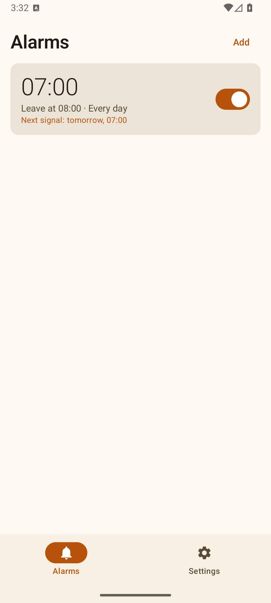

# 出発の時間

[Русский](README.md) · [English](README.en.md) · [Español](README.es.md) ·
[Deutsch](README.de.md) · [**日本語**](README.ja.md) · [Français](README.fr.md) ·
[Português](README.pt.md) · [Italiano](README.it.md)

Android 向けの目覚ましアプリです。1 つのアラームに **起床時刻** と
**家を出る時刻** の 2 つの時刻を持ちます。アラームは複数登録でき、
それぞれに曜日・時刻・設定を持てます。

* 最初の信号は起床時刻ちょうどに鳴ります。
* その後は **5 分または 10 分**ごと（設定可）に音楽が鳴り、起床から出発まで
  続きます。
* 音声アナウンス開始の N 分前（設定可、5〜120）から、システム TTS の
  フレーズが音楽に重なります：「出発まであと 25 分です」。
* 出発のリマインダーは **20・15・10・5 分前**と出発時刻ちょうどに鳴ります：
  「出発の時間です」。
* 出発時刻が起床時刻より早い場合、出発は翌日として扱われます（例：起床
  23:00、出発 07:00）。
* **「リマインダーのみ」**モード — 音楽もバイブもなし、出発の音声
  リマインダーだけ。
* 設定では、フレーズの前に現在時刻を読み上げるかどうかを、アラーム信号・
  出発リマインダー・遅刻リマインダーごとに個別に切り替えられます：
  「ただいま 7 時 5 分です」。
* 曜日：毎日、平日、週末、任意の組み合わせ。
* アラーム編集画面では起床から出発までの準備時間（40〜150 分）を設定します。
  出発時刻だけを指定することもでき、起床時刻は自動計算されます。
* ダークテーマと **8 つの表示言語**：英語（デフォルト）、ロシア語、
  スペイン語、ドイツ語、日本語、フランス語、ポルトガル語、イタリア語。
  言語はシステムに従い、設定で手動選択も可能です。メニューは
  「外観」と「診断」の間にあります。

## スクリーンショット

| アラーム一覧 | アラーム編集 | 信号画面 |
|:---:|:---:|:---:|
|  |  |  |

| 設定 | 言語と GitHub | ダークテーマ |
|:---:|:---:|:---:|
|  |  |  |

## 通知と信号画面

* **起床の 12 時間前**に「アラームを設定しました」という通知が表示され、
  通知シェードに残ります。スワイプして消すと次のサイクルまで再表示され
  ません。設定で通知自体を完全にオフにできます。
* **音楽が鳴っている間**は通知に「スヌーズ」「リマインド」「停止」の
  ボタンが付き、画面には色の異なる 3 つの大きなボタン（明るい色、
  アンバー、暗い色）を持つ**全画面ウィンドウ**が表示され、寝ぼけていても
  押しやすいようになっています。
* 「静かに」は音楽とバイブを止めますが、アラームは動作を続け、次の信号は
  予定どおり鳴ります。
* 「音楽を止めて出発だけ知らせる」は必ず**「本当によろしいですか？」**と
  確認します。確認後は音楽が止まり、出発の音声リマインダーは残ります。
* 「信号を停止」は必ず**「本当によろしいですか？」**と確認し、確認後は
  音楽・リマインダー・スケジュールをオフにし、翌日の自動設定は行いません。
  同じ日を含め、手動で再度アラームを設定できます。
* 通知はサイクルの終わり、または確認済みの停止まで残ります。
* 出発時刻までに手動で止めない場合、出発後は 1 分ごとに音声が 3 回、
  **フレーズの間に 3 秒の間隔**を空けて遅刻を知らせます（音声設定の
  「遅刻」カテゴリ）。同時に信号を停止する提案ウィンドウが表示され、
  リマインダーは手動で止めるまで続きます。

## 仕組み

```
AlarmManager (setAlarmClock、アラームごとに別々の PendingIntent)
        │  信号時刻ちょうどに発火、+30 秒で再試行
        ▼
AlarmReceiver ── 直ちに次の信号を設定し、サービスを起動
        │
        ├─ 「設定済み」: 起床 12 時間前の別アラーム
        ├─ 出発リマインダー: 20/15/10/5/0 分の別アラーム
        └─ 再起動後の遅刻: 復旧用アラーム 1 つ
        ▼
AlarmService (フォアグラウンド, mediaPlayback)
        ├─ MediaPlayer: システムのアラーム音（ループ）
        ├─ VoiceSpeaker: 選択言語の TTS
        ├─ バイブレーション
        ├─ フルスクリーンインテント → AlarmRingingActivity（ボタン付き画面）
        └─ 通知:「スヌーズ」/「リマインド」/「停止」
```

* ステータス通知（ID 1001、チャンネル `alarm_status`）と信号通知
  （ID 1002、チャンネル `alarm_ringing`）を分けており、全画面ウィンドウが
  再度開きます。
* 各信号には 30 秒後の再試行があり、元の信号時刻を保持するため、すでに
  配信された信号が二重に鳴ることはありません。
* 出発信号の後、フォアグラウンドサービスは停止まで動作し続け、1 分ごとの
  リマインダーはその中で実行されます（Doze に制限される別アラームなし）。
* 次の信号は純粋な `SchedulePlanner` ロジックで計算されます（Android 非依存、
  ユニットテスト済み）。
* `setExact*` ではなく `setAlarmClock` を使用：システムはこれを本物の目覚まし
  として扱い、Doze から復帰し、フォアグラウンドサービスのバックグラウンド
  起動制限を受けません。
* アクティブサイクルと停止済みサイクルは device-protected
  SharedPreferences に保存され、再起動・アプリ更新・タイムゾーン変更後に
  `BootReceiver` が信号を再設定します。設定は Direct Boot で利用可能で、
  最初の PIN 入力前にアラームが復元されます。
* TTS は `USAGE_ALARM` でアラーム音量で話し、フレーズ中は音楽が
  ダッキングされます。TTS 言語はアプリ言語に従います。
* オーディオフォーカス `AUDIOFOCUS_GAIN_TRANSIENT` により、信号中は他の
  アプリの音楽/動画が一時停止します。
* 信号画面はロック画面の上に表示され（`showWhenLocked`、`turnScreenOn`）、
  戻るボタンは無効化されています。意識的な選択が必要です。
* ローカルジャーナル `AlarmLog` が信号イベントを記録し、設定の「診断」から
  送信できます（ファイルは FileProvider 経由）。

## 権限

初回起動時に不足している権限を**一度だけ**確認します。付与済みの権限は
再確認しません。

* **正確なアラーム** — これがないと信号が遅れる可能性があります。
* **通知** — 「アラーム設定済み」通知と信号ボタン。
* **信号のポップアップウィンドウ**（Android 14+）— ボタン付きウィンドウを
  ロック画面の上に表示するため。
* **画面の点灯**（Android 14+）— これがないと信号画面がディスプレイを
  点灯できず、音楽は鳴るのに画面が真っ暗のままになります。加えて
  `WakeLock` で画面を起こします。
* **「サイレント」モードへのアクセス** — 音のポリシーが信号を消す可能性が
  ある場合に警告するため。
* **「アラーム信号」チャンネル** — ユーザーがミュートした場合、修正を提案
  します。
* **バッテリー最適化の除外** — Xiaomi、realme/ColorOS、Huawei などの
  ファームウェアでは、これがないと信号が遅れたりプロセスが終了されたり
  します。

音はシステム設定「設定 → サウンド → アラーム」から取得します。
アラーム音が未設定の場合は着信音/通知音、最後の手段として内蔵音を使用
します。

## ビルド

JDK 17+ と Android SDK（compileSdk 36、build-tools 36）が必要です。
プロジェクト：AGP 8.9.1、Gradle 8.11.1、Kotlin 2.0.20、minSdk 26。

```bash
# Windows
set JAVA_HOME=C:\Program Files\Android\Android Studio\jbr
gradlew.bat assembleDebug

# Linux / macOS
./gradlew assembleDebug
```

APK: `app/build/outputs/apk/debug/app-debug.apk`

インストール:

```bash
adb install -r app/build/outputs/apk/debug/app-debug.apk
```

テスト（スケジュールのユニットテストと UI/サービスの Robolectric テスト）:

```bash
gradlew.bat testDebugUnitTest
```

## リリースビルドと Google Play

アプリのパッケージ：`com.gavrovis.navyhod`。

署名はプロジェクトルートのローカル `keystore.properties` から読み込みます
（ファイルと `*.jks` キーは `.gitignore` にあり、リポジトリには入りません）:

```properties
storeFile=navyhod-upload.jks
storePassword=…
keyAlias=navyhod
keyPassword=…
```

Play 用の署名済み App Bundle:

```bash
gradlew.bat bundleRelease
# → app/build/outputs/bundle/release/app-release.aab
```

Play Console で公開する前に、制限付き権限（正確なアラーム、フルスクリーン
インテント、バッテリー最適化の除外、`mediaPlayback` フォアグラウンド
サービスタイプ）の申告、プライバシーポリシー、Data safety フォームの記入が
必要です。ネットワークは不要です。データは収集も送信もされず、ログは
ユーザーが手動で共有します。

## 構成

```
app/src/main/java/com/gavrovis/navyhod/
├── AlarmItem.kt            アラーム：時刻、曜日、準備モード
├── AlarmSettings.kt        共通設定（data class）
├── SettingsStore.kt        device-protected ストレージの SharedPreferences
├── SchedulePlanner.kt      サイクル・信号・遅刻の計算（純粋ロジック）
├── SpeechText.kt           8 言語の TTS フレーズ
├── LocaleHelper.kt         言語の自動選択と Context ラッパー
├── StatusNotifier.kt       通知チャンネルと状態（ID 1001/1002）
├── AlarmScheduler.kt       正確なアラーム、+30 秒再試行、リマインダー
├── AlarmReceiver.kt        アラーム受信 → 次の信号 / サービス
├── AlarmService.kt         音楽、TTS、バイブ、信号画面、遅刻
├── VoiceSpeaker.kt         TextToSpeech ラッパー
├── AlarmRingingActivity.kt ロック画面上の全画面ウィンドウ
├── BootReceiver.kt         再起動/時刻変更後の復旧
├── AlarmLog.kt             診断用のローカルジャーナル
├── MainActivity.kt         エントリポイント、初回のみの権限確認
├── NaVykhodApp.kt          Application
└── ui/
    ├── AppScreen.kt        タブ、アラーム一覧、エディタ
    ├── SettingsTab.kt      信号、音声、通知、テーマ、言語、ログ
    ├── ScreenParts.kt      共通部品とフォーマット
    ├── RingingScreen.kt    信号画面の大きなボタン
    └── theme/Theme.kt      暖かいライト/ダークテーマ
```

リソース：`values`（英語）、`values-ru`、`values-es`、`values-de`、
`values-ja`、`values-fr`、`values-pt`、`values-it`。言語一覧は
`res/xml/locales_config.xml` にあります。

## 制限事項

* メロディはシステムのアラーム音です。独自プレーヤー/プレイリストは
  ありません。
* 信号の音量はシステムのアラーム音量と同じです（ゼロなら他の目覚ましと
  同様に小さくなります）。
* 強力な省電力機能のある一部 OEM 端末では、信頼性はバックグラウンド動作の
  権限に依存します。
* 朝に音楽は鳴るのに画面が点灯しない場合は、設定の「権限と警告」カードを
  確認してください：「信号のポップアップウィンドウ」と「画面の点灯」の
  権限、そして「アラーム信号」チャンネルがミュートされていないこと。
  Android 14+ ではこれらの権限は個別に付与され、システムやユーザーに
  よって取り消されることがあります。
* フレーズ前の現在時刻は、信号・出発リマインダー・遅刻リマインダーごとに
  個別に設定します。音声リマインダー自体はオフにできません。

## ライセンス

MIT ライセンスで公開されています — [LICENSE](LICENSE) を参照してください。
