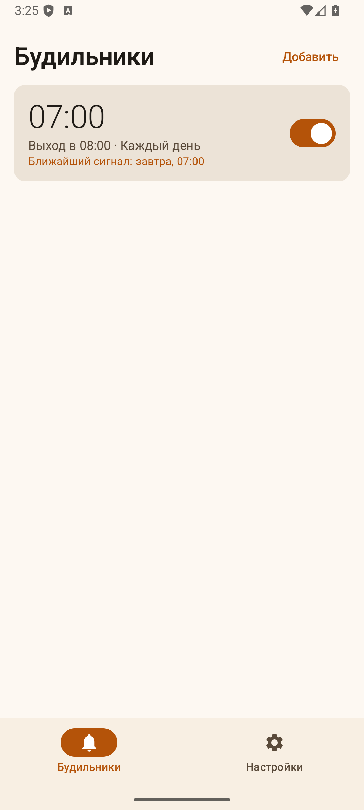
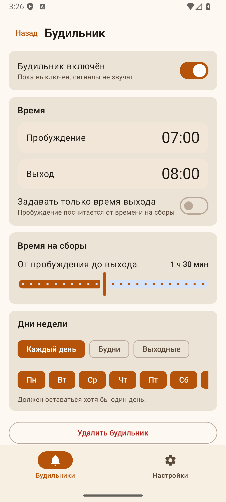
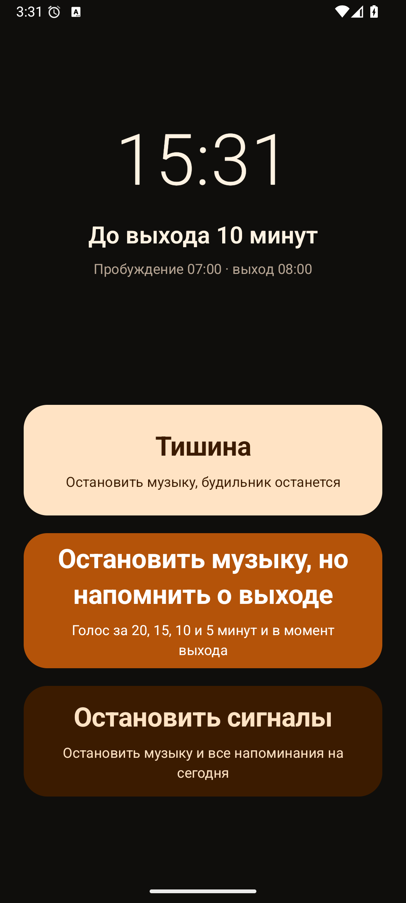
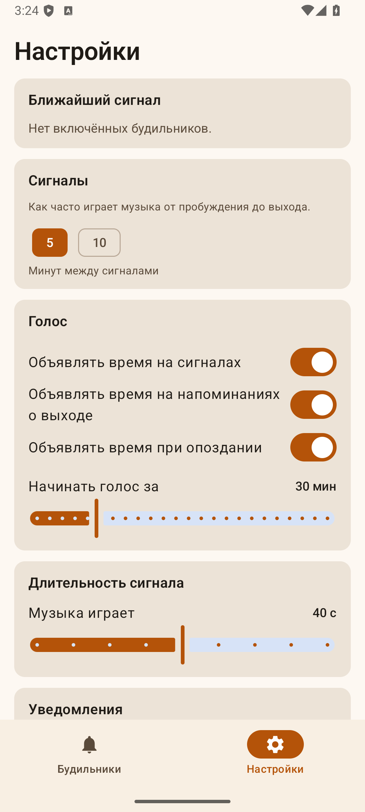
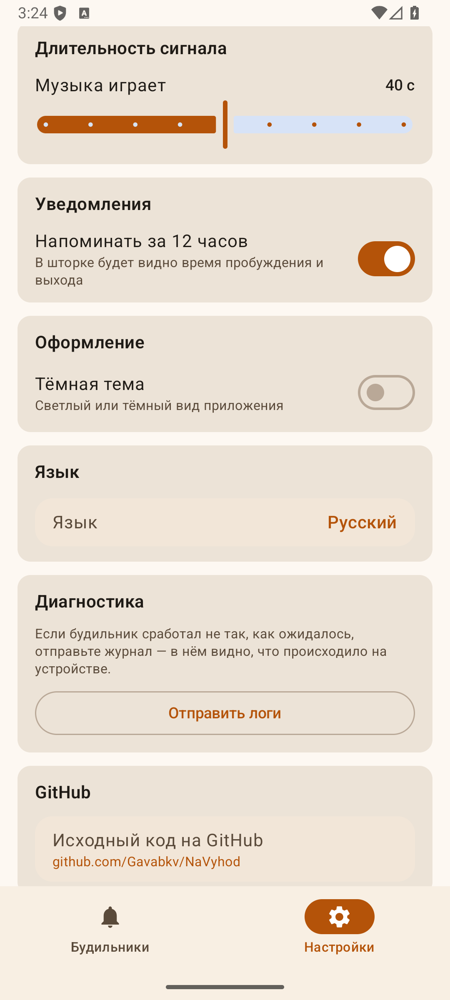
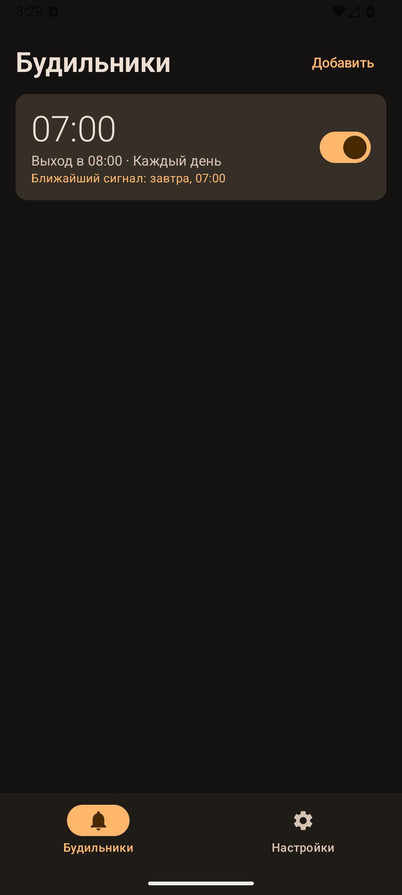

# На выход

[**Русский**](README.md) · [English](README.en.md) · [Español](README.es.md) ·
[Deutsch](README.de.md) · [日本語](README.ja.md) · [Français](README.fr.md) ·
[Português](README.pt.md) · [Italiano](README.it.md)

Будильник для Android с двумя временами на каждый будильник: **пробуждение**
и **выход из дома**. Будильников может быть несколько — у каждого свои дни
недели, времена и настройки.

* Первый сигнал — ровно во время пробуждения.
* Дальше музыка играет каждые **5 или 10 минут** (настраивается) — от
  пробуждения до выхода.
* За N минут до начала голосовых объявлений (настраивается, 5–120) музыка
  дополняется фразами системного TTS: «До выхода осталось 25 минут».
* Напоминания о выходе звучат за **20, 15, 10 и 5 минут** и ровно во время
  выхода: «Пора выходить».
* Если время выхода раньше времени пробуждения, выход считается на следующий
  день (например, пробуждение 23:00, выход 07:00).
* Режим **«только напоминания»** — без музыки и вибрации, только голосовые
  напоминания о выходе.
* В настройках можно включить или выключить текущее время перед фразой —
  отдельно для сигналов будильника, напоминаний о выходе и напоминаний об
  опоздании: «Сейчас 7 часов 5 минут».
* Дни недели: каждый день, будни, выходные или произвольный набор.
* В редакторе будильника задаётся подготовка от пробуждения до выхода
  (40–150 минут); можно задать только время выхода — пробуждение посчитается.
* Тёмная тема и **8 языков интерфейса**: английский (по умолчанию), русский,
  испанский, немецкий, японский, французский, португальский и итальянский.
  Язык берётся из системы, его можно выбрать вручную в настройках — меню
  находится между «Оформлением» и «Диагностикой».

## Скриншоты

| Будильники | Редактор будильника | Окно сигнала |
|:---:|:---:|:---:|
|  |  |  |

| Настройки | Язык и GitHub | Тёмная тема |
|:---:|:---:|:---:|
|  |  |  |

## Уведомления и окно сигнала

* **За 12 часов до пробуждения** появляется уведомление «Будильник заведён»
  и просто висит. Его можно смахнуть — тогда оно не вернётся до следующего
  цикла. Уведомление можно полностью отключить в настройках.
* **В момент музыки** к уведомлению добавляются кнопки «Отложить»,
  «Напомнить» и «Остановить», а на экран выводится **полноэкранное окно**
  с тремя крупными кнопками разных цветов (светлая, янтарная и тёмная) —
  чтобы попасть спящему.
* «Тишина» останавливает музыку и вибрацию, но будильник продолжает
  работать: следующие сигналы прозвучат по расписанию.
* «Остановить музыку, но напомнить о выходе» обязательно спрашивает
  **«Вы уверены?»**: после подтверждения музыка выключается, а голосовые
  напоминания о выходе остаются.
* «Остановить сигналы» обязательно спрашивает **«Вы уверены?»** и после
  подтверждения выключает музыку, напоминания и расписание без автоматического
  включения завтра. Будильник можно вручную завести снова, в том числе
  в тот же день.
* Уведомление живёт до конца цикла или до подтверждённого выключения.
* Если до времени выхода будильник не выключен вручную, после выхода каждую
  минуту голос трижды сообщает об опоздании с паузой **3 секунды между
  фразами** (категория «Опоздание» в настройках голоса). Одновременно
  появляется окно с предложением остановить сигналы; напоминания идут до
  ручного отключения.

## Как это устроено

```
AlarmManager (setAlarmClock, отдельный PendingIntent на каждый будильник)
        │  срабатывает ровно в момент сигнала, повтор +30 секунд
        ▼
AlarmReceiver ── сразу ставит следующий сигнал и запускает сервис
        │
        ├─ «заведён»: отдельный аларм за 12 часов до пробуждения
        ├─ напоминания о выходе: отдельные алармы на 20/15/10/5/0 минут
        └─ опоздание после перезапуска: один восстановительный аларм
        ▼
AlarmService (foreground, mediaPlayback)
        ├─ MediaPlayer: системный звук будильника (loop)
        ├─ VoiceSpeaker: TTS на выбранном языке
        ├─ вибрация
        ├─ full-screen intent → AlarmRingingActivity (окно с кнопками)
        └─ уведомление: «Отложить» / «Напомнить» / «Остановить»
```

* Уведомление статуса (ID 1001, канал `alarm_status`) отделено от уведомления
  сигнала (ID 1002, канал `alarm_ringing`), чтобы полноэкранное окно
  открывалось заново.
* У каждого сигнала есть повтор через 30 секунд; он несёт исходное время
  сигнала, поэтому уже доставленный сигнал не срабатывает дважды.
* После сигнала выхода foreground-сервис остаётся активным до отключения:
  минутные напоминания идут внутри него, без отдельных алармов,
  ограничиваемых Doze.
* Следующий сигнал вычисляет чистая логика `SchedulePlanner`
  (без Android-зависимостей, покрыта юнит-тестами).
* `setAlarmClock` используется вместо обычного `setExact*`: система считает
  такой сигнал настоящим будильником — он выходит из Doze и не попадает
  под ограничения фонового запуска foreground-сервисов.
* Активный цикл и остановленный цикл хранятся в device-protected
  SharedPreferences; после перезагрузки, обновления приложения или смены
  часового пояса `BootReceiver` ставит сигналы заново. Настройки доступны
  в Direct Boot: сигнал восстанавливается до первого ввода PIN.
* TTS говорит через `USAGE_ALARM`, громкость та же, что у будильника;
  на время фразы музыка приглушается. Язык TTS следует языку приложения.
* Аудиофокус `AUDIOFOCUS_GAIN_TRANSIENT` ставит на паузу музыку/видео
  в других приложениях, пока играет сигнал.
* Окно сигнала показывается поверх блокировки (`showWhenLocked`,
  `turnScreenOn`), кнопка «назад» заблокирована: выбор нужно сделать осознанно.
* Локальный журнал `AlarmLog` пишет события сигналов; в настройках его можно
  отправить через «Диагностику» (файл передаётся через FileProvider).

## Разрешения

При первом запуске приложение **один раз** проходит по недостающим разрешениям;
уже выданные не спрашиваются повторно.

* **Точные будильники** — без них сигнал может опоздать.
* **Уведомления** — уведомление «будильник заведён» и кнопки сигнала.
* **Всплывающее окно сигнала** (Android 14+) — чтобы окно с кнопками
  появлялось поверх блокировки.
* **Включение экрана** (Android 14+) — без него окно сигнала может не разбудить
  дисплей: музыка играет, а экран остаётся чёрным. Дополнительно экран будится
  через `WakeLock`.
* **Доступ к режиму «Не беспокоить»** — чтобы предупреждать, если политика
  звука может заглушить сигнал.
* **Канал «Сигнал будильника»** — если пользователь его заглушил, приложение
  предложит исправить.
* **Игнорирование экономии батареи** — на прошивках Xiaomi, realme/ColorOS,
  Huawei и т.п. без этого сигналы могут задерживаться или процесс убивается.

Звук берётся из системных настроек: «Настройки → Звук → Будильник».
Если мелодия будильника не задана, используется мелодия звонка/уведомления,
а в крайнем случае — встроенный тон.

## Сборка

Нужны JDK 17+ и Android SDK (compileSdk 36, build-tools 36).
Проект: AGP 8.9.1, Gradle 8.11.1, Kotlin 2.0.20, minSdk 26.

```bash
# Windows
set JAVA_HOME=C:\Program Files\Android\Android Studio\jbr
gradlew.bat assembleDebug

# Linux / macOS
./gradlew assembleDebug
```

APK: `app/build/outputs/apk/debug/app-debug.apk`

Установка:

```bash
adb install -r app/build/outputs/apk/debug/app-debug.apk
```

Тесты (юнит-тесты расписания и Robolectric-тесты UI/сервиса):

```bash
gradlew.bat testDebugUnitTest
```

## Релизная сборка и Google Play

Пакет приложения: `com.gavrovis.navyhod`.

Подпись берётся из локального `keystore.properties` в корне проекта
(файл и ключ `*.jks` в `.gitignore` и в репозиторий не попадают):

```properties
storeFile=navyhod-upload.jks
storePassword=…
keyAlias=navyhod
keyPassword=…
```

Сборка подписанного App Bundle для Play:

```bash
gradlew.bat bundleRelease
# → app/build/outputs/bundle/release/app-release.aab
```

Перед публикацией в Play Console нужны декларации для ограниченных
разрешений (точные будильники, full-screen intent, исключение из оптимизации
батареи, тип foreground-сервиса `mediaPlayback`), политика конфиденциальности
и заполненная форма Data safety. Сеть приложению не нужна: данные не
собираются и никуда не отправляются, логи пользователь передаёт вручную.

## Структура

```
app/src/main/java/com/gavrovis/navyhod/
├── AlarmItem.kt            будильник: времена, дни, режим подготовки
├── AlarmSettings.kt        общие настройки (data class)
├── SettingsStore.kt        SharedPreferences в device-protected storage
├── SchedulePlanner.kt      расчёт цикла, сигналов, опозданий (чистая логика)
├── SpeechText.kt           фразы TTS на 8 языках
├── LocaleHelper.kt         автовыбор языка и обёртка контекста
├── StatusNotifier.kt       каналы и состояния уведомлений (ID 1001/1002)
├── AlarmScheduler.kt       точные алармы, повторы +30 с, напоминания
├── AlarmReceiver.kt        приём алармов → следующий сигнал / сервис
├── AlarmService.kt         музыка, TTS, вибрация, окно сигнала, опоздание
├── VoiceSpeaker.kt         обёртка над TextToSpeech
├── AlarmRingingActivity.kt полноэкранное окно поверх блокировки
├── BootReceiver.kt         восстановление после перезагрузки/смены времени
├── AlarmLog.kt             локальный журнал для диагностики
├── MainActivity.kt         точка входа, разовый опрос разрешений
├── NaVykhodApp.kt          Application
└── ui/
    ├── AppScreen.kt        вкладки, список будильников, редактор
    ├── SettingsTab.kt      сигналы, голос, уведомления, тема, язык, логи
    ├── ScreenParts.kt      общие элементы и форматирование
    ├── RingingScreen.kt    крупные кнопки окна сигнала
    └── theme/Theme.kt      тёплая светлая/тёмная тема
```

Пакеты ресурсов: `values` (английский), `values-ru`, `values-es`, `values-de`,
`values-ja`, `values-fr`, `values-pt`, `values-it`; список языков —
в `res/xml/locales_config.xml`.

## Ограничения

* Мелодия — системный звук будильника; своего плеера/плейлиста нет.
* Громкость сигнала равна громкости будильника в системе (если она на нуле —
  будет тихо, как и у любого будильника).
* На устройствах с агрессивным энергосбережением (некоторые OEM) надёжность
  зависит от разрешения на работу в фоне.
* Если утром музыка играет, а дисплей не загорается, проверьте карточку
  «Разрешения и предупреждения» в настройках: разрешения «Всплывающее окно
  сигнала» и «Включение экрана», а также что канал «Сигнал будильника»
  не заглушён. На Android 14+ эти разрешения выдаются отдельно и могут быть
  отозваны системой или пользователем.
* Текущее время перед фразой настраивается отдельно для сигналов, напоминаний
  о выходе и напоминаний об опоздании. Сами голосовые напоминания
  не отключаются.
