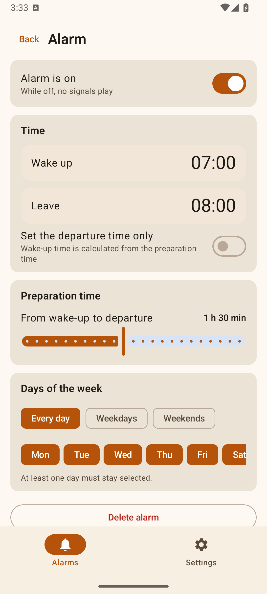
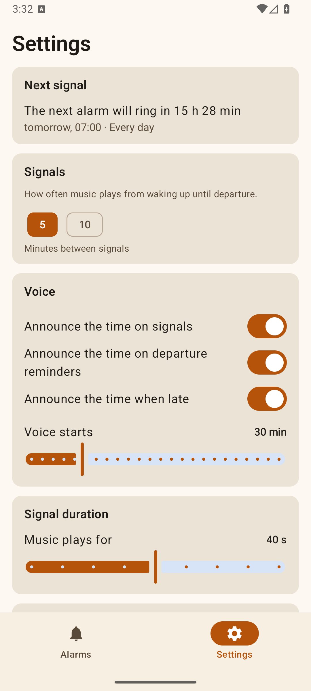
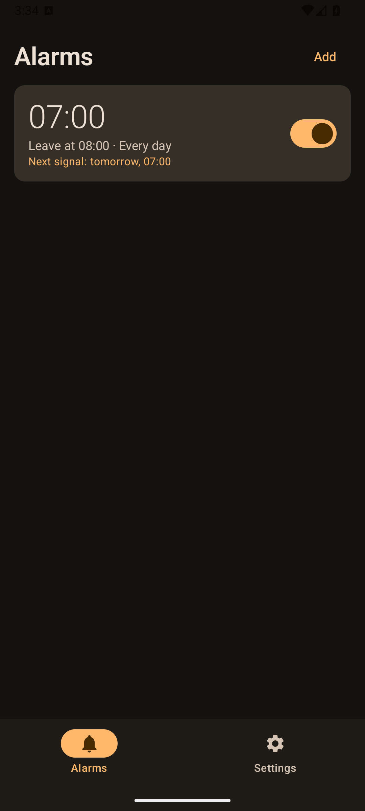

# Hora de sair

[Русский](README.md) · [English](README.en.md) · [Español](README.es.md) ·
[Deutsch](README.de.md) · [日本語](README.ja.md) · [Français](README.fr.md) ·
[**Português**](README.pt.md) · [Italiano](README.it.md)

Despertador para Android com dois horários por alarme: **acordar** e **sair de
casa**. É possível criar vários alarmes — cada um com seus dias da semana,
horários e ajustes.

* O primeiro sinal toca exatamente na hora de acordar.
* Depois a música toca a cada **5 ou 10 minutos** (configurável), do acordar
  até a saída.
* N minutos antes do início dos anúncios de voz (configurável, 5–120), a
  música é complementada por frases TTS do sistema: «Faltam 25 minutos para
  sair».
* Os lembretes de saída tocam **20, 15, 10 e 5 minutos** antes e exatamente na
  hora de sair: «Hora de sair».
* Se o horário de saída for anterior ao de acordar, a saída conta no dia
  seguinte (por exemplo, acordar 23:00, sair 07:00).
* Modo **«somente lembretes»** — sem música nem vibração, apenas lembretes de
  voz sobre a saída.
* Nos ajustes é possível ligar ou desligar a hora atual antes da frase —
  separadamente para sinais de alarme, lembretes de saída e de atraso: «Agora
  são 7 horas e 5 minutos».
* Dias da semana: todos os dias, dias úteis, fins de semana ou qualquer
  conjunto.
* No editor do alarme define-se a preparação do acordar até a saída
  (40–150 minutos); também é possível informar apenas o horário de saída — o
  de acordar é calculado.
* Tema escuro e **8 idiomas de interface**: inglês (padrão), russo, espanhol,
  alemão, japonês, francês, português e italiano. O idioma segue o sistema e
  pode ser escolhido manualmente nos ajustes — o menu fica entre «Aparência»
  e «Diagnóstico».

## Capturas de tela

| Alarmes | Editor de alarme | Tela do sinal |
|:---:|:---:|:---:|
|  |  |  |

| Ajustes | Idioma e GitHub | Tema escuro |
|:---:|:---:|:---:|
|  |  |  |

## Notificações e tela do sinal

* **12 horas antes de acordar** aparece a notificação «Alarme definido» e
  fica no painel. Pode ser deslizada para descartar — então não volta até o
  próximo ciclo. A notificação pode ser desligada por completo nos ajustes.
* **Enquanto a música toca**, a notificação ganha os botões «Adiar»,
  «Lembrar» e «Parar», e na tela surge uma **janela em tela cheia** com três
  botões grandes de cores diferentes (claro, âmbar e escuro) para que uma
  pessoa sonolenta consiga acertá-los.
* «Silêncio» para a música e a vibração, mas o alarme continua funcionando:
  os próximos sinais tocam conforme o planejado.
* «Parar a música, mas lembrar de sair» sempre pergunta **«Tem certeza?»**:
  após confirmar, a música para e os lembretes de voz sobre a saída
  continuam.
* «Parar os sinais» sempre pergunta **«Tem certeza?»** e, após confirmar,
  desliga música, lembretes e a programação sem reativar automaticamente
  amanhã. O alarme pode ser redefinido manualmente, inclusive no mesmo dia.
* A notificação permanece até o fim do ciclo ou até uma parada confirmada.
* Se o alarme não for parado manualmente antes da hora de saída, após a saída
  a voz anuncia o atraso três vezes a cada minuto com uma **pausa de
  3 segundos entre as frases** (categoria «Atraso» nos ajustes de voz). Ao
  mesmo tempo aparece uma janela oferecendo parar os sinais; os lembretes
  continuam até a desativação manual.

## Como funciona

```
AlarmManager (setAlarmClock, um PendingIntent separado por alarme)
        │  dispara exatamente na hora do sinal, repetição +30 segundos
        ▼
AlarmReceiver ── agenda imediatamente o próximo sinal e inicia o serviço
        │
        ├─ «definido»: alarme separado 12 horas antes de acordar
        ├─ lembretes de saída: alarmes separados em 20/15/10/5/0 minutos
        └─ atraso após reinício: um alarme de recuperação
        ▼
AlarmService (foreground, mediaPlayback)
        ├─ MediaPlayer: som de alarme do sistema (loop)
        ├─ VoiceSpeaker: TTS no idioma escolhido
        ├─ vibração
        ├─ full-screen intent → AlarmRingingActivity (janela com botões)
        └─ notificação: «Adiar» / «Lembrar» / «Parar»
```

* A notificação de status (ID 1001, canal `alarm_status`) é separada da
  notificação do sinal (ID 1002, canal `alarm_ringing`) para que a janela em
  tela cheia abra de novo.
* Cada sinal tem uma repetição após 30 segundos que carrega a hora original
  do sinal, assim um sinal já entregue nunca dispara duas vezes.
* Após o sinal de saída o serviço foreground continua ativo até ser
  desligado: os lembretes por minuto rodam dentro dele, sem alarmes separados
  limitados pelo Doze.
* O próximo sinal é calculado pela lógica pura `SchedulePlanner` (sem
  dependências do Android, coberta por testes unitários).
* Usa-se `setAlarmClock` em vez de `setExact*`: o sistema trata esse alarme
  como um despertador real — ele sai do Doze e não sofre as restrições de
  início em segundo plano de serviços foreground.
* O ciclo ativo e o ciclo parado ficam em SharedPreferences protegidas pelo
  dispositivo; após reiniciar, atualizar o app ou trocar de fuso horário, o
  `BootReceiver` reagenda os sinais. Os ajustes ficam disponíveis no Direct
  Boot: o alarme é restaurado antes do primeiro PIN.
* O TTS fala via `USAGE_ALARM` no volume do alarme; durante a frase a música é
  atenuada. O idioma do TTS segue o idioma do app.
* O foco de áudio `AUDIOFOCUS_GAIN_TRANSIENT` pausa música/vídeo de outros
  apps enquanto o sinal toca.
* A janela do sinal aparece sobre o bloqueio de tela (`showWhenLocked`,
  `turnScreenOn`) e o botão voltar fica bloqueado: a escolha precisa ser
  consciente.
* O diário local `AlarmLog` registra os eventos dos sinais; nos ajustes ele
  pode ser enviado por «Diagnóstico» (o arquivo é compartilhado via
  FileProvider).

## Permissões

No primeiro início o app percorre **uma vez** as permissões faltantes; as já
concedidas não são pedidas de novo.

* **Alarmes exatos** — sem elas o sinal pode atrasar.
* **Notificações** — a notificação «alarme definido» e os botões do sinal.
* **Janela pop-up do sinal** (Android 14+) — para que a janela com botões
  apareça sobre o bloqueio.
* **Acender a tela** (Android 14+) — sem isso a janela do sinal pode não
  acender o display: a música toca e a tela fica preta. Além disso a tela é
  acesa via `WakeLock`.
* **Acesso a «Não perturbe»** — para avisar se a política de som puder abafar
  o sinal.
* **Canal «Sinal de alarme»** — se o usuário o silenciou, o app propõe
  corrigir.
* **Ignorar a otimização de bateria** — em firmwares Xiaomi, realme/ColorOS,
  Huawei e similares, sem isso os sinais podem atrasar ou o processo é
  encerrado.

O som vem dos ajustes do sistema: «Configurações → Som → Alarme».
Se nenhum som de alarme estiver definido, usa-se o som de
chamada/notificação e, em último caso, um tom integrado.

## Compilação

Requer JDK 17+ e Android SDK (compileSdk 36, build-tools 36).
Projeto: AGP 8.9.1, Gradle 8.11.1, Kotlin 2.0.20, minSdk 26.

```bash
# Windows
set JAVA_HOME=C:\Program Files\Android\Android Studio\jbr
gradlew.bat assembleDebug

# Linux / macOS
./gradlew assembleDebug
```

APK: `app/build/outputs/apk/debug/app-debug.apk`

Instalação:

```bash
adb install -r app/build/outputs/apk/debug/app-debug.apk
```

Testes (unitários do planejamento e Robolectric de UI/serviço):

```bash
gradlew.bat testDebugUnitTest
```

## Build de release e Google Play

Pacote do aplicativo: `com.gavrovis.navyhod`.

A assinatura é lida do `keystore.properties` local na raiz do projeto
(o arquivo e a chave `*.jks` estão no `.gitignore` e não vão para o
repositório):

```properties
storeFile=navyhod-upload.jks
storePassword=…
keyAlias=navyhod
keyPassword=…
```

Build do App Bundle assinado para o Play:

```bash
gradlew.bat bundleRelease
# → app/build/outputs/bundle/release/app-release.aab
```

Antes de publicar no Play Console são necessárias declarações para permissões
restritas (alarmes exatos, full-screen intent, isenção da otimização de
bateria, tipo de serviço foreground `mediaPlayback`), política de
privacidade e o formulário Data safety preenchido. O app não precisa de rede:
nenhum dado é coletado ou enviado, os logs o usuário compartilha manualmente.

## Estrutura

```
app/src/main/java/com/gavrovis/navyhod/
├── AlarmItem.kt            alarme: horários, dias, modo de preparação
├── AlarmSettings.kt        ajustes comuns (data class)
├── SettingsStore.kt        SharedPreferences em armazenamento protegido
├── SchedulePlanner.kt      cálculo de ciclo, sinais e atrasos (lógica pura)
├── SpeechText.kt           frases TTS em 8 idiomas
├── LocaleHelper.kt         seleção automática de idioma e wrapper de contexto
├── StatusNotifier.kt       canais e estados de notificação (ID 1001/1002)
├── AlarmScheduler.kt       alarmes exatos, repetições +30 s, lembretes
├── AlarmReceiver.kt        recepção dos alarmes → próximo sinal / serviço
├── AlarmService.kt         música, TTS, vibração, janela do sinal, atraso
├── VoiceSpeaker.kt         wrapper de TextToSpeech
├── AlarmRingingActivity.kt janela em tela cheia sobre o bloqueio
├── BootReceiver.kt         recuperação após reinício/mudança de hora
├── AlarmLog.kt             diário local para diagnóstico
├── MainActivity.kt         ponto de entrada, varredura única de permissões
├── NaVykhodApp.kt          Application
└── ui/
    ├── AppScreen.kt        abas, lista de alarmes, editor
    ├── SettingsTab.kt      sinais, voz, notificações, tema, idioma, logs
    ├── ScreenParts.kt      elementos comuns e formatação
    ├── RingingScreen.kt    botões grandes da janela do sinal
    └── theme/Theme.kt      tema claro/escuro quente
```

Conjuntos de recursos: `values` (inglês), `values-ru`, `values-es`,
`values-de`, `values-ja`, `values-fr`, `values-pt`, `values-it`; a lista de
idiomas fica em `res/xml/locales_config.xml`.

## Limitações

* A melodia é o som de alarme do sistema; não há player nem playlist próprios.
* O volume do sinal é o volume de alarme do sistema (se estiver em zero, será
  baixo, como em qualquer despertador).
* Em aparelhos com economia de energia agressiva (alguns OEMs), a
  confiabilidade depende da permissão de trabalho em segundo plano.
* Se pela manhã a música toca mas a tela não acende, verifique o cartão
  «Permissões e avisos» nos ajustes: as permissões «Janela pop-up do sinal» e
  «Acender a tela», e se o canal «Sinal de alarme» não está silenciado. No
  Android 14+ essas permissões são concedidas separadamente e podem ser
  revogadas pelo sistema ou pelo usuário.
* A hora atual antes da frase é configurada separadamente para sinais,
  lembretes de saída e de atraso. Os próprios lembretes de voz não podem ser
  desligados.

## Licença

Distribuído sob a licença MIT — veja [LICENSE](LICENSE).
